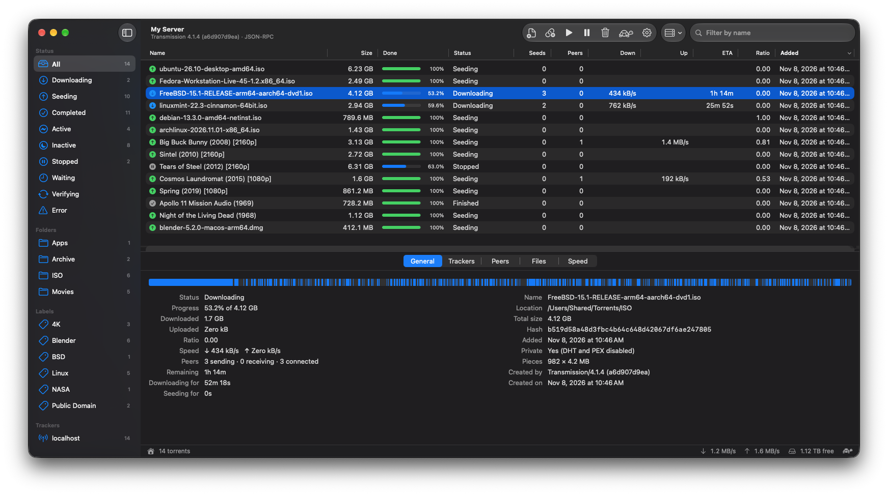
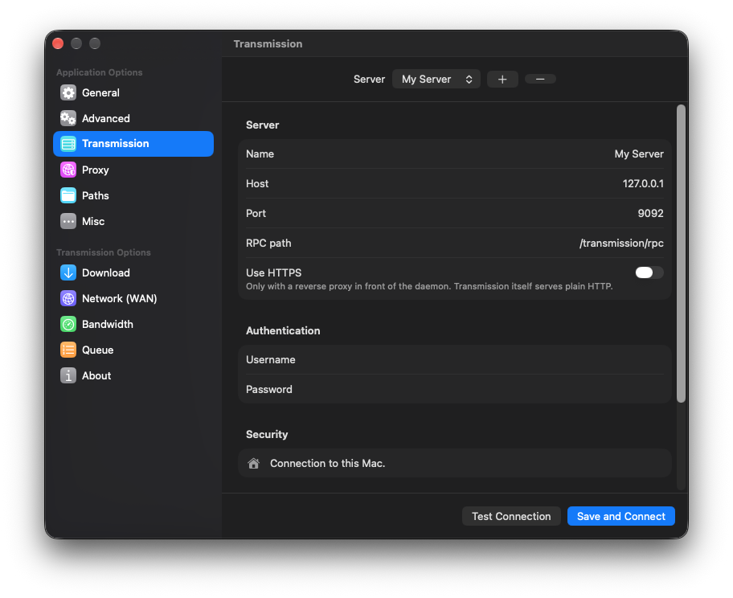
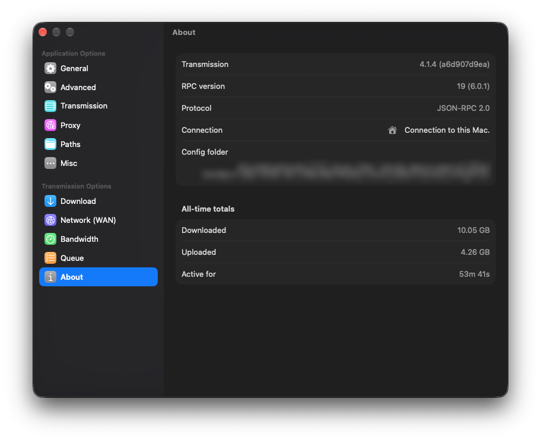

# Transmission Remote

A native macOS client for [Transmission](https://transmissionbt.com) daemons, written in SwiftUI.
It replaces [Transmission Remote GUI](https://github.com/transmission-remote-gui/transgui)
(the Lazarus/Free Pascal app; the `lighterowl` fork was archived in November 2025) with a modern Mac app
that keeps transgui's layout: filter sidebar, sortable torrent list, tabbed info pane and status bar.

- **macOS 26** or later, Apple silicon or Intel
- Works with **Transmission 2.40 through 4.x**, including Transmission 3.00 on Western Digital
  My Cloud and other NAS boxes
- In **28 languages**, the same ones Transmission Remote GUI has
- Moving from transgui? **Import** your servers, passwords, path mappings and folder history from
  `transgui.ini` in Settings → Transmission
- A native **Windows 11** version (x64 and ARM64) is in development in [`Windows/`](Windows/)



## Download and install

1. Download `TransmissionRemote-<version>.dmg` from the
   [latest release](https://github.com/a1darufa/TransmissionRemote/releases/latest) and open it.
   Drag **TransmissionRemote** onto the **Applications** folder in the window that appears, then eject
   the disk image.
2. Open it. The app isn't signed with an Apple Developer ID or notarized by Apple, so macOS blocks
   the first launch and says it can't verify the app. Click **Done**.
3. Open **System Settings → Privacy & Security**, scroll down to the message about TransmissionRemote,
   and click **Open Anyway**. Confirm with your password. After this, the app opens normally.

If you prefer Terminal, this removes the download flag instead of steps 2–3:

```bash
xattr -dr com.apple.quarantine /Applications/TransmissionRemote.app
```

After you update to a new version, macOS may ask once whether the app can use the server passwords it
saved in your Keychain. Choose **Always Allow**.

## Features

| Area | What you get |
|---|---|
| Torrent list | 27 columns (11 shown by default, the rest via right-click on the header), sortable, with order, widths and visibility remembered. Seeds and Peers show the swarm's size too, like "3 (172)" |
| Sidebar | Status filters (All, Downloading, Seeding, Completed, Active, Inactive, Stopped, Waiting, Verifying, Error) plus Folders, Labels and Trackers, each with counts |
| Info pane | General (with a pieces bar), Trackers, Peers (host names, and countries with flags), Files (tree with checkboxes and priorities; Open, Show in Finder, Rename and Copy Path), Speed (live chart) |
| Adding | Open dialog, drag and drop, double-click in Finder, browser magnet links, ⌘V paste. The Add sheet shows the file tree, the destination folder (with history ranked by use, like transgui), free space, start, priority, labels and sequential download |
| Actions | Open and Show in Finder (through path mappings), Start, Start Now, Stop, Verify, Reannounce, Move Data, Rename, Labels, per-torrent limits (also from preset speed menus), Edit Trackers, bandwidth priority, queue moves, Copy Magnet Link, Remove, and Remove and Delete Data |
| Server | Daemon settings (speed, alternative-speed schedule, folders, port test, encryption, peers, queue, seeding, blocklist), bandwidth groups (Transmission 4.0+), turtle mode, preset global speed limit menus, Start All / Stop All |
| Connections | Multiple saved servers, each optionally reached through an HTTP or SOCKS 5 proxy, with a client certificate for HTTPS reverse proxies that ask for one. Import from `transgui.ini` |
| Mac integration | Menu bar extra with speeds, a completion notification, refresh that slows down in the background, a daily check for new releases |

Settings keep transgui's grouping in a System Settings-style window: app options at the top, the
connected daemon's options below.

<p align="center">
  
  
</p>

### Keyboard shortcuts

| Action | Shortcut | transgui |
|---|---|---|
| Add torrent file / link | ⌘O / ⌘U | Insert / ⌘Insert |
| Start / Start Now / Stop | ⌘/ / ⇧⌘/ / ⌘. | F3 / Shift+F3 / F4 |
| Start All / Stop All | ⌥⌘/ / ⌥⌘. | ⌘F3 / ⌘F4 |
| Remove / Remove and Delete Data | ⌘⌫ / ⌥⌘⌫ | Del / Shift+Del |
| Reannounce | ⌘R | ⌘R |
| Move Data | ⇧⌘M | F6 |
| Labels | ⌘L | F7 |
| Torrent Options | ⌥⌘I | Alt+Enter |
| Queue up / down / top / bottom | ⌥⌘↑ / ⌥⌘↓ / ⇧⌥⌘↑ / ⇧⌥⌘↓ | ⌘1 / ⌘2 / ⇧⌘1 / ⇧⌘2 |
| Alternative speed limits | ⇧⌘T | F8 |
| Server settings | ⌥⌘, | F9 |
| Info pane / sidebar | ⌘I / ⌃⌘S | F12 / F11 |

## Protocol compatibility

Transmission 4.1 switched to JSON-RPC 2.0 with snake_case keys. Older releases only speak the original
protocol, which mixes camelCase and kebab-case keys.

On connect the client sends a legacy `session-get`, which every release understands. It then uses
**JSON-RPC 2.0** when the server reports RPC 6.0.0 or newer, and the **legacy protocol** otherwise.
Each server can also be forced to legacy under *Settings → Servers → Advanced*.

One set of Swift models covers both protocols:

- Incoming keys are normalized to camelCase.
- Outgoing keys are spelled per protocol: snake_case for JSON-RPC, and the documented legacy exceptions
  (`files-wanted`, `peer-limit`, `seedRatioLimit`, …) otherwise. See `RPCDialect.swift`.
- Fields an older server doesn't know (labels before 3.00, `trackerList` and bandwidth groups before 4.0,
  sequential download before 4.1) are never requested. Features that depend on them are hidden or fall back, for example
  tracker editing through `trackerAdd` / `trackerRemove` on 3.00.
- Decoding is lenient where releases differ: `wanted` as 0/1, speed limits as doubles in 4.1.0, and
  encryption mode `tolerated` vs `allowed`.

## Security

Transmission's RPC server only speaks plain HTTP with Basic auth, so the password travels with every
request. The daemon can't be changed, so the client compensates:

| | Transmission Remote GUI | This app |
|---|---|---|
| Password storage | Saved in `transgui.ini` | macOS Keychain, bound to the app's signature |
| HTTPS | Optional, certificate errors could be ignored | System trust, TLS 1.2 minimum. Self-signed certificates only by **pinning** their SHA-256 fingerprint after you confirm it |
| Redirects | Followed | **Refused**, so the `Authorization` header can't be replayed to another host |
| Plain HTTP over the internet | Allowed silently | **Blocked** until you allow it per server. Loopback, private LAN ranges and **Tailscale** (`100.64.0.0/10`, `fd7a:115c:a1e0::/48`, `*.ts.net`) are allowed, and the status bar shows which applies |
| Cookies, caches, credential storage | Default | Ephemeral session: nothing written to disk |
| App permissions | Unrestricted | App Sandbox + Hardened Runtime: outgoing network and read-only access to files you open, nothing else |
| `.torrent` parsing | Trusted | Bounded parser with a size limit (32 MB), depth limit and no unchecked lengths |
| Clipboard | Polled for links | Read only when you paste |
| Client certificates | File paths and password in `transgui.ini` | The `.p12` file and its password in the Keychain, imported in memory only when connecting |

Besides your Transmission servers, the app contacts only two other places:

- **GitHub**, once a day, to see whether a newer release exists (Settings → General, can be turned off).
  Nothing is downloaded or installed automatically.
- **DB-IP**, for the free IP-to-country database behind the Peers tab's flags: only after you click
  Download there, then once a month. Host names come from your Mac's usual DNS.

Recommended setups for exposing a daemon, from best to worst:

1. A VPN such as Tailscale or WireGuard, with plain HTTP inside the tunnel
2. A reverse proxy with HTTPS in front of the daemon
3. LAN only

Also enable `rpc-whitelist` and `rpc-host-whitelist` on the daemon. The app explains the 403 and 421
errors those settings produce.

## Reporting a problem

The app keeps a log of connections, failed requests and other errors. Choose **Help → Show Log Files**
and attach the file for the day the problem happened to your
[issue](https://github.com/a1darufa/TransmissionRemote/issues). Each failed request is logged with the
command, the protocol, how long it took and the error, which is usually enough to find the cause.

The files are in `~/Library/Containers/com.a1dar.TransmissionRemote/Data/Library/Logs` and are deleted
after 14 days. They never contain passwords, but they do contain server addresses and torrent names,
so look them over before posting. If the app crashed, also attach the crash report from Console →
Crash Reports.

## Building

This repository holds both apps: the Mac app in `macOS/` and the Windows app in `Windows/` (see
[its README](Windows/README.md)). The commands below run from `macOS/`.

Open `macOS/TransmissionRemote.xcodeproj` in Xcode 26 or later and run. The project uses folder-synchronized
groups, so new files in `TransmissionRemote/` are picked up automatically. On the first build, Xcode asks
you to trust the SwiftLint plugin (see [Code style](#code-style)); choose *Trust & Enable*.

From the command line:

```bash
cd macOS
xcodebuild -project TransmissionRemote.xcodeproj -scheme TransmissionRemote -configuration Release \
  -destination 'generic/platform=macOS' -derivedDataPath build/DerivedData -skipPackagePluginValidation build
```

The generic destination builds a universal app (Apple silicon and Intel). `-skipPackagePluginValidation`
lets the SwiftLint plugin run without the trust prompt Xcode shows on the first build. To install it on the Mac you
built it on, copy it to Applications:

```bash
ditto build/DerivedData/Build/Products/Release/TransmissionRemote.app /Applications/TransmissionRemote.app
```

A copy built and installed this way opens normally on that Mac.

To make a release download, run `macOS/Scripts/build-release.sh`. It builds a universal Release app that is
ad-hoc signed instead of signed with a developer certificate, and packs it into a disk image in
`macOS/build/release/` with a drag-to-Applications window (`macOS/Scripts/dmg/`). Laying out that window goes through
Finder, so macOS asks once to let your terminal control Finder. Downloads aren't notarized, so people
approve the first launch themselves (see [Download and install](#download-and-install)).

Signing uses development team `B48N6YBGWS` and bundle ID `com.a1dar.TransmissionRemote`. Change both under
*Signing & Capabilities* if needed. Keychain items are tied to the signing identity, so a different
team means re-entering server passwords.

## Code style

[SwiftLint](https://github.com/realm/SwiftLint) 0.65.1 runs on every build as a build tool plugin
(from [SwiftLintPlugins](https://github.com/SimplyDanny/SwiftLintPlugins)), in Xcode and with
`swift build` / `swift test`. Violations show up as build warnings. The version is pinned in
`Package.resolved`, so nobody needs to install SwiftLint.

- `macOS/.swiftlint.yml` holds the rules: SwiftLint's defaults plus opt-in rules for safety (no force unwraps),
  collection idioms, modern Swift and consistent formatting.
- `macOS/Packages/TransmissionKit/.swiftlint.yml` only points to that file, because the plugin looks for a
  configuration inside the package directory.
- Where a rule doesn't fit, the code disables it for one line and says why, as in `Bencode.swift`.

To lint or autocorrect from the terminal with the pinned version:

```bash
cd macOS
swift package --package-path Packages/TransmissionKit resolve
Packages/TransmissionKit/.build/artifacts/swiftlintplugins/SwiftLintBinary/SwiftLintBinary.artifactbundle/macos/swiftlint lint
```

Pass `--fix` instead of `lint` to autocorrect, then review the diff and build. Two autocorrections need
care: the `#expect` macro can't take a key-path argument such as `allSatisfy(\.wanted)`, and methods named
`test…` lose `private` even outside test classes.

## Testing

```bash
cd macOS/Packages/TransmissionKit && swift test
```

The unit tests cover:

- Key mapping and request envelopes for both protocols
- Decoding of 3.00-style and 4.1-style responses
- Endpoint validation and transport-security classification
- `.torrent` and magnet parsing, including malformed input
- The client's CSRF handshake, protocol detection and error mapping (against a mocked network)
- Tracker summaries, bandwidth groups in both protocols, and client certificates
- The IP-to-country database, gzip unpacking, release version checks and `transgui.ini` import

The integration suite runs the full lifecycle against a **throwaway** daemon over both JSON-RPC and
the legacy protocol: add, files, labels, options, verify, trackers, rename, move, queue, remove and
session settings. It never deletes data and restores session settings afterwards.

```bash
brew install transmission-cli
mkdir -p /tmp/trtest/{config,downloads}
# Put the data for a test torrent in /tmp/trtest/downloads, then create the torrent:
transmission-create -p -t http://127.0.0.1:6969/announce -o /tmp/trtest/test.torrent "/tmp/trtest/downloads/<folder>"
transmission-daemon --foreground --config-dir /tmp/trtest/config --rpc-bind-address 127.0.0.1 --port 19091 \
  --auth --username tester --password "<test password>" --no-dht --no-lpd --no-portmap &

TRANSMISSION_IT_HOST=127.0.0.1 TRANSMISSION_IT_PORT=19091 TRANSMISSION_IT_USER=tester \
TRANSMISSION_IT_PASSWORD_FILE=/path/to/file-containing-test-password \
TRANSMISSION_IT_TORRENT=/tmp/trtest/test.torrent TRANSMISSION_IT_DOWNLOAD_DIR=/tmp/trtest/downloads \
swift test --filter IntegrationTests
```

Run the daemon with `--foreground`. When it forks into the background on macOS, it crashes on its first
`torrent-add`.

## Project layout

```
macOS/                           the Mac app
  Packages/TransmissionKit/      UI-free core, unit-tested with Swift Testing
    Transport/                   client actor, protocol dialects, envelopes, endpoint security, TLS pinning
    Diagnostics/                 DiagnosticLog: unified log plus daily log files
    Models/                      Torrent, TorrentDetails, SessionSettings, request types
    API/                         typed calls: torrents, actions, session, groups, free space, port test
    Metainfo/                    bencode parser, .torrent metainfo, magnet links
    GeoIP/                       IP-to-country lookup and gzip unpacking for peer flags
    Import/                      transgui.ini reader
    Updates/                     GitHub release version check
    Resources/                   the package's String Catalog
  TransmissionRemote/            the SwiftUI app (default MainActor isolation, Swift 6)
    App/                         scenes and menu commands
    Model/                       AppModel, ServerConnection (polling and actions), ServerStore, Keychain
    Views/                       main window, info pane tabs, sheets, settings, menu bar extra
    *.xcstrings                  String Catalogs: the interface and Info.plist texts in 28 languages
  Config/                        Info.plist additions (torrent and magnet handling) and entitlements
  Scripts/                       release build and disk image
Windows/                         the Windows app, in development: see Windows/README.md
  src/TransmissionKit/           the C# port of the core, with the same folders as the Swift package
  tests/TransmissionKit.Tests/   its MSTest suite
.github/workflows/               CI for the Windows core on x64 and ARM64
CLAUDE.md                        working rules for Claude Code in this repository
docs/screenshots/                the screenshots in this README
docs/transgui-audit.md           transgui's open issues and pull requests, checked against this app
```

## Translations

The app speaks the 28 languages Transmission Remote GUI does: English, Belarusian, Catalan, Chinese
(Simplified and Traditional), Croatian, Czech, Danish, Dutch, Finnish, French, German, Greek, Hungarian,
Italian, Korean, Latvian, Lithuanian, Norwegian, Polish, Portuguese (Portugal and Brazil), Romanian,
Russian, Spanish, Swedish, Turkish and Ukrainian. It follows the language chosen in System Settings.

The translations were made with AI help, reusing transgui's own translations for torrent terms so
they feel familiar, and Apple's wording for macOS features. Native speakers' corrections are very
welcome: the texts live in `macOS/TransmissionRemote/Localizable.xcstrings`, which Xcode edits directly.

## Credits

Transmission Remote is made by **Aidar Abdullin** ([a1darufa](https://github.com/a1darufa)). Aidar came up
with the app, designed how it looks and works, made the product decisions and tested every build
against real Transmission servers. The code was written together with
[Claude](https://www.anthropic.com/claude) by Anthropic as an AI pair programmer, which is why commits
list Claude as co-author.

The app icon is the [Transmission](https://transmissionbt.com) project's own Liquid Glass icon,
copied unmodified from
[`macosx/Images/Transmission_Tahoe.icon`](https://github.com/transmission/transmission/tree/147da724531235c3f2d42a5bf63d2d201d347663/macosx/Images/Transmission_Tahoe.icon)
in the Transmission repository. It is © the Transmission authors and is used under Transmission's
licence (GNU GPLv2 or GPLv3).

Peer countries come from [IP to Country Lite by DB-IP](https://db-ip.com), licensed under
[CC BY 4.0](https://creativecommons.org/licenses/by/4.0/). The app downloads it only when you ask.

This app is an independent project. It is not made or endorsed by the Transmission team.

## License

Transmission Remote is free software, © 2026 Aidar Abdullin. You can redistribute it and/or modify
it under the terms of the [GNU General Public License](LICENSE), version 3 or (at your option) any
later version. It comes with no warranty.

Transmission and Transmission Remote GUI are GPL projects too, and the app icon is used under its
GPLv3 option.
